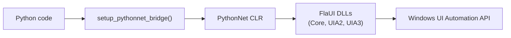

# Advanced

XPath, combined conditions, tree walking, caching, retries, fluent assertions and input timing.
Each recipe shows **Python** next to the original FlaUI **C#**.

!!! success "Every Python snippet on this page runs"
    The Python tabs are included from
    [`examples/pytest/test_advanced.py`](https://github.com/amruthvvkp/flaui-uiautomation-wrapper/blob/master/examples/pytest/test_advanced.py),
    which runs against the bundled WPF app:

    ```bash
    uv run pytest examples/pytest/test_advanced.py -v
    ```

    The snippets assume `window`, `cf` (`automation.cf`) and `automation`, as in the
    [pytest example](examples/pytest.md).

## Element methods by type

Each page in the [API Reference](api/index.md) lists every method, including inherited ones. The
highlights:

- **Button**: `invoke`, `click`, `right_click`, `double_click`
- **CheckBox**: `toggle`, `toggle_state`, `is_checked`
- **RadioButton**: `is_checked` (get / set)
- **ComboBox / ComboBoxItem**: `select(value | index)`, `items`, `selected_item`, `expand` / `collapse`
- **TextBox**: `text` (get / set), `enter`
- **ListBox / ListBoxItem**: `select(index | text)`, `items`, `selected_item`
- **Slider / Spinner**: `value` (get / set), `minimum`, `maximum`, `small_increment`, ...
- **Tab / TabItem**: `select_tab_item`, `selected_tab_item`, `tab_items`
- **Tree / TreeItem**: `items`, `expand`, `collapse`, `select`, `selected_tree_item`
- **Grid / DataGridView**: `header`, `rows`, `cells`, `select`
- **Window**: `title`, `close`, `modal_windows`, `title_bar`, `context_menu`
- **Menu / MenuItem**: `items`, `invoke`, `expand`

## Finding elements

FlaUI has two main ways to find elements: the **ConditionFactory** (fast and specific) and
**XPath** (flexible and structural).

### Tree scope

Every search has a scope:

- **Children**: direct children only (one level down): `find_first_child` / `find_all_children`.
- **Descendants**: the whole subtree: `find_first_descendant` / `find_all_descendants`.
- **Ancestors**: walk upwards: `parent`, or the tree walker below.

Descendant searches can be slow on large trees. Prefer children, or start from a closer container,
when you know the structure.

### ConditionFactory vs XPath

| | ConditionFactory | XPath |
| --- | --- | --- |
| **Speed** | Very fast (native UIA query) | Slower (walks the tree) |
| **Stability** | High (IDs, control types) | High when the path uses IDs |
| **Strength** | Single-element lookups | Relationships (`//Tab/TabItem`) |
| **Use it for** | The default | Structural queries |

### XPath

=== "Python"

    ```python
    --8<-- "examples/pytest/test_advanced.py:xpath"
    ```

=== "C#"

    ```csharp
    var button = window.FindFirstByXPath("//Button[@AutomationId='InvokableButton']").AsButton();
    var tabs = window.FindAllByXPath("//Tab/TabItem");
    var checkBox = window.FindFirstByXPath("//CheckBox[@Name='Test Checkbox']").AsCheckBox();
    ```

### Combining conditions (And / Or / Not)

=== "Python"

    ```python
    --8<-- "examples/pytest/test_advanced.py:conditions"
    ```

=== "C#"

    ```csharp
    var invoke = cf.ByControlType(ControlType.Button).And(cf.ByAutomationId("InvokableButton"));
    var radios = cf.ByAutomationId("RadioButton1").Or(cf.ByAutomationId("RadioButton2"));
    // C#'s Not() takes no argument and negates the condition it is called on:
    var twoState = cf.ByControlType(ControlType.CheckBox).And(cf.ByAutomationId("ThreeStateCheckBox").Not());

    var button = window.FindFirstDescendant(invoke);
    var radioButtons = window.FindAllDescendants(radios);
    var checkBoxes = window.FindAllDescendants(twoState);
    ```

!!! warning "`Not` takes an argument in Python"
    In C#, `ConditionBase.Not()` negates the condition it is called on. The Python
    `PropertyCondition.Not(other)` means **self AND NOT other**, which is the common case written
    as one call.

Other factory methods: `by_name`, `by_text`, `by_class_name`, `by_help_text`, `by_value`,
`by_framework_id`, `by_framework_type`, `by_process_id`, `by_localized_control_type`. See the
[Condition Factory reference](api/condition_factory.md).

### Filtering results in Python

`find_all_*` returns an `AutomationElementCollection`. It is a `list` with a few extra helpers
(see [Pythonic API](pythonic-api.md#element-collections)):

=== "Python"

    ```python
    --8<-- "examples/pytest/test_advanced.py:collections"
    ```

=== "C#"

    ```csharp
    var buttons = window.FindAllDescendants(cf.ByControlType(ControlType.Button));
    var first = buttons.FirstOrDefault();
    var enabled = buttons.Where(b => b.IsEnabled).ToArray();
    var invokable = buttons.Where(b => b.AutomationId == "InvokableButton").ToArray();
    ```

## Tree walking

The tree walker steps through the tree one sibling at a time. `automation.tree_walker` is FlaUI's
raw-view `ITreeWalker`, so its methods take and return the raw C# elements (`.raw_element`).

=== "Python"

    ```python
    --8<-- "examples/pytest/test_advanced.py:tree_walker"
    ```

=== "C#"

    ```csharp
    var walker = automation.TreeWalkerFactory.GetRawViewWalker();
    var types = new List<ControlType>();
    var child = walker.GetFirstChild(window);
    while (child != null)
    {
        types.Add(child.ControlType);
        child = walker.GetNextSibling(child);
    }
    var children = window.FindAllChildren();
    ```

## Caching (CacheRequest)

Every property read is a cross-process call. A `CacheRequest` pre-fetches chosen properties for the
elements found while it is active, which pays off when you read many elements at once.

=== "Python"

    ```python
    --8<-- "examples/pytest/test_advanced.py:cache_request"
    ```

=== "C#"

    ```csharp
    var cacheRequest = new CacheRequest { TreeScope = TreeScope.Element };
    cacheRequest.Add(automation.PropertyLibrary.Element.Name);

    using (cacheRequest.Activate())
    {
        var buttons = window.FindAllDescendants(cf.ByControlType(ControlType.Button));
        var names = buttons.Select(b => b.Name).ToList();
    }
    ```

Cache trees that don't change while you read them. Leave caching off for UI that updates live.

## Retry and polling

=== "Python"

    ```python
    --8<-- "examples/pytest/test_advanced.py:retry"
    ```

=== "C#"

    ```csharp
    var button = Retry.WhileNull(
        () => window.FindFirstDescendant(cf.ByAutomationId("InvokableButton")),
        timeout: TimeSpan.FromSeconds(5),
        interval: TimeSpan.FromMilliseconds(100),
        throwOnTimeout: true).Result.AsButton();

    var ready = Retry.WhileFalse(() => button.IsEnabled, TimeSpan.FromSeconds(2)).Result;
    ```

!!! note "Timeouts are milliseconds in Python"
    C# `Retry` takes `TimeSpan` values and returns a `RetryResult<T>`. The Python `Retry` methods
    take integer **milliseconds** and return the value directly.

## Fluent assertions (`expect`)

Playwright-style assertions that keep polling until the condition holds or the timeout runs out.
This is a Python addition with no direct C# equivalent; in C# you would combine `Retry` with
your test framework's asserts.

=== "Python"

    ```python
    --8<-- "examples/pytest/test_advanced.py:expect"
    ```

=== "C#"

    ```csharp
    textBox.Text = "42";
    Assert.That(Retry.WhileFalse(() => !textBox.IsOffscreen, TimeSpan.FromSeconds(5)).Result);
    Assert.That(Retry.WhileFalse(() => textBox.IsEnabled, TimeSpan.FromSeconds(2)).Result);
    Assert.That(Retry.WhileFalse(() => textBox.Text == "42", TimeSpan.FromSeconds(5)).Result);
    ```

## Input timing (`post_wait`)

Mouse methods, `click`, `TextBox.enter` and `Tab.select_tab_item` accept `post_wait`:
`True` (~100 ms), a number of seconds, or a callable.

=== "Python"

    ```python
    --8<-- "examples/pytest/test_advanced.py:post_wait"
    ```

=== "C#"

    ```csharp
    Mouse.Click(textBox.GetClickablePoint());
    Wait.UntilInputIsProcessed();
    textBox.AsTextBox().Enter("typed");
    Thread.Sleep(250);
    ```

## Exception translation

Every method that crosses into C# is decorated with `@handle_csharp_exceptions`, which turns .NET
exceptions into the [Python exception hierarchy](api/exceptions.md). For example, a missing
element raises `ElementNotFound`, and an unsupported pattern raises `PatternNotSupportedException`.
Catch those, not `System.Exception`. If you add a new wrapper method, give it the same decorator.

## Page objects

Group element look-ups in a small class that mirrors your app's screens. The project's own suite
does this in `tests/test_utilities/elements/`:

=== "Python"

    ```python
    class SimpleControls:
        """Element accessors for the Simple Controls tab."""

        def __init__(self, window: Window, cf: ConditionFactory) -> None:
            self._window, self._cf = window, cf

        @property
        def invoke_button(self) -> Button:
            return self._window.find_first_descendant(self._cf.by_automation_id("InvokableButton")).as_button()
    ```

=== "C#"

    ```csharp
    public class SimpleControls(Window window, ConditionFactory cf)
    {
        public Button InvokeButton =>
            window.FindFirstDescendant(cf.ByAutomationId("InvokableButton")).AsButton();
    }
    ```

## Inspection tools

- **FlaUInspect**: best for exploring patterns and properties. It uses the same FlaUI engine.
- **Accessibility Insights**: quick property look-ups and accessibility checks.

## How the bridge works



## When to use what

- **ConditionFactory**: fast, stable lookups by ID or control type. **This is the default.**
- **XPath**: relationships between elements and structural queries.
- **Tree walker**: step-by-step traversal when you know the structure.
- **CacheRequest**: reading many properties from a tree that isn't changing.
- **Retry / `expect`**: slow dialogs, asynchronous content, and assertions that need to wait.
